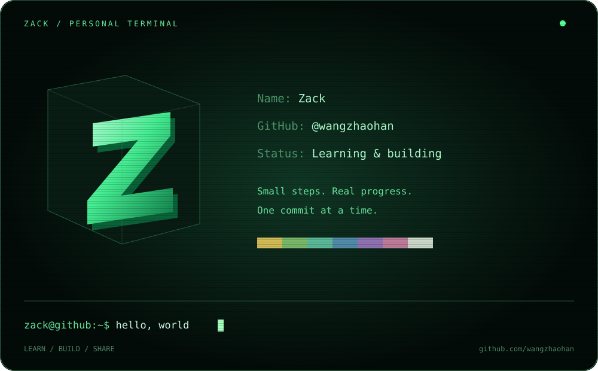

  

  <b>Hi, I'm Zack.</b> 
  Learning, building, and sharing—one commit at a time. 
  持续学习，把想法变成作品，记录每一步进步。

### Contributions · 我的绿格子

每一个格子，都是一天的积累。这里记录我的代码提交、协作与探索。

[查看我的真实 GitHub 贡献记录 →](https://github.com/wangzhaohan?tab=overview#year-list-container)
